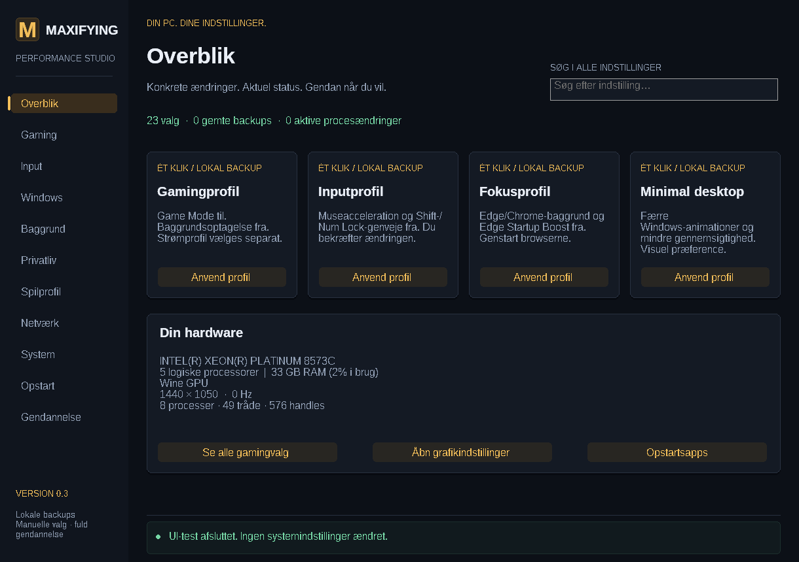

# Maxifying 0.3 · Performance Studio

**[Download Maxifying.exe](https://github.com/BallinSoftwareSolutions/chaattest/raw/refs/heads/gametune-download/downloads/Maxifying.exe)**

Hvis download ikke starter: [åbn filen på GitHub](https://github.com/BallinSoftwareSolutions/chaattest/blob/gametune-download/downloads/Maxifying.exe), og klik på pilen **Download raw file**. Log ind på GitHub, hvis repository'et er privat. Find derefter filen i Downloads på din Windows 11-pc.

## Hvad er nyt?

Maxifying hed tidligere GameTune. Eksisterende backups og historik genbruges, så du stadig kan gendanne gamle ændringer.

Et native C++17-dashboard med mørkt design, gyldne accenter, side-navigation, søgning, aktuelle statusværdier, detaljer pr. indstilling og bekræftelse før ændringer. Vinduet skaleres ned, så det passer på mindre skærme. Ingen konto eller database.

| Kategori | Individuelle indstillinger |
|---|---|
| Gaming · 3 | Game Mode, Game DVR/App Capture fra, høj ydeevne-strømprofil |
| Input · 6 | Museacceleration, markørspor, neutral musehastighed, Sticky Keys-genvej, Toggle Keys-genvej, Filter Keys |
| Windows · 7 | Gennemsigtighed, vinduesanimation, menuanimation, tooltip-animation, indholdsanimation, markørskygge, versionsafhængige web-søgeforslag |
| Baggrund · 3 | Edge-baggrundstilstand, Edge Startup Boost, Chrome-baggrundstilstand |
| Privatliv · 2 | Windows-reklame-id og tilpassede oplevelser med diagnosedata |
| Spilprofil · 2 | Højtydende GPU-præference og valgfri fullscreen-kompatibilitetstest for en valgt .exe |

**23 indstillinger**, plus følgende værktøjer:

- **Fire profiler:** gaming, input, fokus og minimal desktop. Fokus slår Edge/Chrome-baggrundstilstand og Edge Startup Boost fra; genstart browserne bagefter. En dialog viser de præcise ændringer før godkendelse. Power-plan, Filter Keys og fullscreen-eksperimenter medtages ikke automatisk.
- **Netværk:** fire ICMP-pakker til en valgfri IPv4-adresse med RTT og pakketab, håndtering af manglende svar samt DNS-cache-rydning via Windows' ipconfig. Ping måler netværks-RTT, ikke input-latency.
- **Hardware:** CPU, logiske processorer, RAM-forbrug, skærmadapter, opløsning, opdateringsfrekvens samt aktuelle proces-, tråd- og handle-antal.
- **Procesprioritet:** Above Normal til en konkret kørende app med et synligt hovedvindue (også minimeret). Den originale prioritet gendannes ved normal applukning eller manuelt. Ved appcrash varer ændringen indtil spilprocessen afsluttes. Ingen Realtime-prioritet eller automatisk CPU-affinity.
- **Luk valgt app:** sender en normal lukkeanmodning til den valgte apps synlige hovedvinduer efter bekræftelse. Appen kan bede om at gemme eller vælge at blive i systembakken. Processer tvangsafsluttes ikke; kendte Windows-systemprocesser filtreres fra listen.
- **Opstart:** deaktiver/gendan navngivne opstartsposter i den aktuelle brugers Run-nøgle. Programmet afinstalleres ikke. Task Managers godkendelser, tjenester, planlagte opgaver og andre brugere er uden for denne liste.
- **Gendannelse:** individuelle backups, gendan alle inklusive tidligere valgte spil og opstartsposter, vedvarende aktivitetshistorik og eksport af en tekstrapport.

## UI og animationer

- Bufferbaseret vindues- og knaptegning, så baggrund og tekst vises samlet.
- Statusopdateringer genbruger eksisterende knapper og bevarer tastaturfokus.
- Korte hover-, tryk-, switch- og succesanimationer samt glidende sidepane-markering og sideovergange.
- Almindelige ændringer, profiler, DNS-rydning og gendan alle kører i en worker, mens UI'en forbliver tilgængelig. Ændringsknapper låses under arbejdet, og succes vises først efter resultatet.
- Bekræftelse bevares for profiler og valg, der ændrer strøm, tilgængelighed, følsomhed eller fullscreen-kompatibilitet. Andre individuelle valg anvendes ved direkte klik.
- Animationstimeren stopper, når effekterne er afsluttet. Hardwareopdateringer tegner kun den relevante del af vinduet. Sideovergange respekterer Windows' klientanimationsindstilling ved opstart.

Færre processer er ikke i sig selv et mål for højere FPS. Fokusprofilen, opstartsoversigten og lukkeanmodninger kan reducere valgfri baggrundsaktivitet; Maxifying deaktiverer ikke alle Windows-baggrundsprocesser eller ombygger Windows som et OS-playbook.

## Virkning og kontrol

Appen ændrer intet ved opstart. Den gemmer første originalværdi med datatype og data i `HKCU/Software/GameTune/Backup`. Gendannelse bevarer også oprindeligt manglende registerværdier. Gamle backups fra første GameTune-version understøttes. Undgå at lade flere optimizer-apps styre samme indstilling samtidig: gendannelse bruger den første gemte original, ikke eventuelle senere ændringer.

Hver ændring forklares i **Info**. Windows-indstillinger læses tilbage; system-API-ændringer bliver ikke markeret som gennemført, hvis de ikke kan bekræftes. Et registerflag beviser ikke, at et spil, en browser eller en organisationspolitik følger flaget. Browserpolitikker kræver browsergenstart og kan overstyres af organisationens politik. Game Mode/GPU/compatibility kræver typisk genstart af spil; visse Windows-politikker kan kræve ny login-session.

Strømprofilen kan være utilgængelig på Modern Standby-maskiner. GPU-præferencer er ønsker til Windows og kan overstyres af driver/spil. Fullscreen-eksperimentet kan forringe ydelse, VRR og Alt-Tab og vælges kun manuelt. Tilgængelighedsfunktioner vises utilgængelige, når Windows ikke rapporterer understøttelse.

FPS og input-latency afhænger af spil og hardware. Visuelle præferencer og privatlivsvalg er ikke dokumenterede FPS-forbedringer. Appen foretager ikke automatisk HPET-/timer-, MSI-, interrupt-, driver-, CSRSS-, TCP-, sikkerhedsmitigerings- eller Windows Update-ændringer. Den lover ikke risikofri tuning eller Hones fulde funktionsparitet.

## Byg på Windows

Visual Studio 2022 Build Tools med Desktop development with C++ og CMake. Fra Developer PowerShell:

```powershell
cmake -S . -B build -A x64
cmake --build build --config Release
ctest --test-dir build -C Release --output-on-failure
.\build\Release\Maxifying.exe
```

Standardtesten bruger isolerede syntetiske registernøgler og ændrer ikke gaming-indstillinger. `MaxifyingTests.exe --system-settings` anvender og gendanner rigtige mus-/tastatur-/animationsindstillinger og bør kun køres i en disponibel testkonto eller VM.

## Linux / cloud

```sh
sh scripts/build-linux.sh
sh scripts/build-tests-linux.sh
```

Forberedt compiler: `/workspace/mingw/usr/bin/x86_64-w64-mingw32-g++-posix`. En anden MinGW-compiler og resource-compiler kan vælges via `MAXIFYING_CXX` og `MAXIFYING_RC` (de gamle `GAMETUNE_*`-navne accepteres også). Appen indeholder ikon, versionsmetadata og Windows-manifest og bruger statisk C++-runtime. `downloads/GameTune.exe` bevares som en identisk kompatibilitetskopi til gamle links. Output og checksum ligger i `downloads/` og er gemt i Git, så download ikke afhænger af cloud-sessionen.

## Validering

Luk den tidligere GameTune-version, før du åbner Maxifying. Den gamle downloadadresse leverer også den nye version.

Se [testresultater og begrænsninger](docs/VALIDATION.md). Brugerfladen og understøttede indstillingsændringer er afprøvet i Wine; native Windows 11 og FPS/latency i rigtige spil mangler stadig test.


